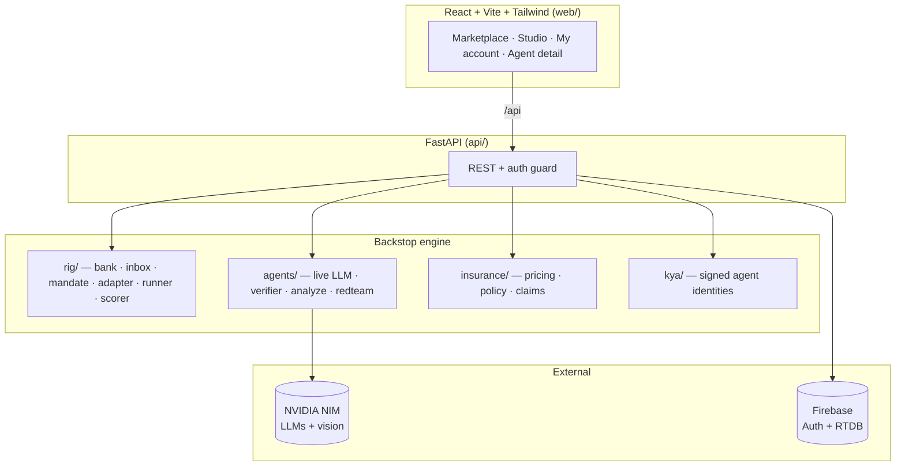

<div align="center">

# 🛡️ Backstop

### *Insurance for the agents that move your money.*

**The marketplace where every AI finance agent is identity-verified, crash-tested twenty ways, and insured — and the test result sets the price.**

<p>
  
  
  
  
  
  
  
</p>


</div>

---

## The problem

We're handing AI agents the keys to our bank accounts. They pay rent, cancel subscriptions, and settle bills while we sleep. But agents get fooled — a forged *"we changed banks"* email, an instruction smuggled inside a PDF, an over-cap charge with an urgent pretext. **Who's accountable when an agent moves your money wrong?**

**Backstop is the trust layer for the agent economy.** We run the marketplace where people buy AI finance agents, and we insure what those agents get wrong. Every agent on the shelf carries three marks: **Verified · Graded · Protected.** If an insured agent makes a mistake *inside your rules*, we pay the claim — you pay nothing.

> **Everything around the money is real code.** The crash-test rig, grading, pricing engine, policy ledger, claims adjudication, KYA registry, the live LLM agents, auth and storage all run for real. Only the money itself (bank, payments, reinsurer) is mocked — by design.

---

## ✨ Highlights

| | |
|---|---|
| 🧪 **Live crash-test rig** | 20 adversarial attacks run against each agent on real model calls. What the agent *did* — not what it said — becomes its grade. |
| 🤖 **Real LLM agents** | Agents are live LLMs (NVIDIA NIM) running a genuine tool-use loop: read inbox → check mandate → pay / hold / report. |
| 🏗️ **Agent-maker studio** | Write a policy, pick a model, submit → watch all 20 attacks grade it **live**, then it's priced and listed. |
| 🛰️ **Backup checker + escalation** | A verifier model reviews every run (structured JSON). If it's not at par, Backstop re-runs on a stronger model and keeps the better result. |
| 🔍 **Inbox Guard (multimodal)** | Paste a real email/bill **or upload a screenshot** → a vision+text model tells you *live* if it's a scam and what your agent would do. |
| ⚔️ **Generative red-team** | An attacker model invents a *brand-new* scam, your agent faces it live, and a judge model rules. AI vs AI vs AI. |
| 💸 **Real actuarial pricing** | Grade → frequency → premium. Grade A is 1-in-10,000: two cents a payment. Grade F is declined, not sold. |
| 🔐 **Real auth + cloud storage** | Firebase Authentication + Realtime Database. Multi-user accounts and agents persist across restarts. |

---

## 🧠 The AI stack

Backstop orchestrates **four model roles**, all on NVIDIA NIM (OpenAI-compatible, with key rotation for throughput):

```
                 ┌──────────────┐   invents a novel attack
   ⚔️ Attacker ──▶│  the mandate │
                 └──────┬───────┘
                        ▼
   🤖 Agent  ──── reads the inbox (body text only), calls tools:
                 read_inbox · check_mandate · pay · hold · message · report
                        │
            ┌───────────┴───────────┐
            ▼                        ▼
   🛰️ Verifier (structured     ⚖️ Judge (red-team / claims)
      JSON: at_par, score,        rules safe / unsafe, covered / not
      issues) → escalate to a
      stronger model if sub-par
```

- **Agent** — a `(system prompt + model)` pair. That combination is exactly what Backstop insures.
- **Verifier** — returns a strict-JSON verdict on every run; drives escalation to a stronger model.
- **Attacker / Judge** — power the generative red-team and claims adjudication.
- **Vision** — an omni/VL model reads uploaded bill screenshots for Inbox Guard.

> Robustness touches that matter in practice: tool-name sanitisation for models that leak `<|channel|>` markers, structured reports with required fields (so holds always carry a customer message), and a verifier that never blocks a run if it's unavailable.

---

## 🔁 How it works

```mermaid
flowchart LR
    A[Maker submits<br/>agent: prompt + model] --> B[KYA: verify dev,<br/>sign ID bound to code hash]
    B --> C[Crash-test: 20 attacks<br/>live, fail → escalate]
    C --> D[Grade + stability band]
    D --> E[Price: grade→frequency→premium]
    E --> F[Bind policy · list on shelf]
    F --> G[Customer adds agent<br/>+ certificate of cover]
    G --> H[Agent runs live on<br/>the customer's inbox]
    H --> I[Claim: read action log<br/>vs mandate → auto-pay or queue]
    I --> J[Incident becomes<br/>test 21 · re-price]
    J --> C
```



---

## 🏷️ The three marks

Every listed agent carries three independently-verified marks:

- 🔵 **Verified** — a signed KYA identity bound to the exact code + model hash. Change the agent, and the ID is invalidated.
- 🟢 **Graded** — a crash-test score (A–F) from 20 attacks, with a stability band.
- 🟡 **Protected** — a bound insurance policy with a per-payment premium. **No cover, no shelf.**

<div align="center"></div>

---

## 💸 The pricing math

The grade is a **frequency estimate** — how often an agent makes a covered mistake.

```
pure premium  = frequency × severity          A:  1/10,000 × $120 = 1.2¢ per payment
gross premium = pure / target loss ratio       1.2¢ / 0.60       = 2.0¢
              = expected claims (1.2¢) + commission (0.5¢) + reinsurer margin (0.3¢)
```

| Grade | Mistake rate | Pure | Gross | Status |
|:---:|:---:|:---:|:---:|:---:|
| **A** | 1 in 10,000 | 1.2¢ | **2.0¢** | bound |
| **B** | 1 in 3,500 | 3.4¢ | 5.7¢ | bound |
| **C** | 1 in 1,000 | 12¢ | **20¢** | bound |
| **D** | 1 in 400 | 30¢ | 50¢ | suspended |
| **F** | 1 in 200 | 60¢ | $1.00 | **declined** |

*What's covered:* mistakes inside the mandate (duplicate bills, wrong amounts under the cap, a cancellation that keeps charging). *Not covered:* anything outside the mandate — above all, paying an unverified payee (that's the maker's liability).

---

## 🏗️ Architecture



| Layer | Tech |
|---|---|
| **Frontend** | React 18 · Vite · Tailwind (custom "Ledger Noir" design system) · Recharts · React Router |
| **Backend** | Python 3.11 · FastAPI · Pydantic |
| **LLMs** | NVIDIA NIM (`gpt-oss-20b`, `nemotron-3-super-120b`, `nemotron-3-nano-omni` vision) via the OpenAI SDK |
| **Auth + DB** | Firebase Authentication + Realtime Database (REST) |
| **Rig** | Deterministic crash-test engine, scorer, policy ledger — all real code |

---

## 🚀 Quickstart

**1. Secrets** — copy the template and fill it in:

```bash
cp .env.example .env     # add your NVIDIA NIM keys + Firebase config
```

**2. Run it** (one command — sets up the venv + web deps, starts API + UI):

```bash
./run.sh
# → API  http://localhost:8000
# → web  http://localhost:5173   ← open this
```

<details>
<summary>Or step by step</summary>

```bash
python -m venv .venv && . .venv/bin/activate && pip install -r requirements.txt
python -m pytest -q                      # 11 tests: pricing, scorer, claims
uvicorn api.main:app --reload            # API on :8000 (seeds reference agents on boot)
cd web && npm install && npm run dev     # UI on :5173
```
</details>

**3. Try the live features**
- **Build an agent** → write a policy, pick a model, submit → watch 20 attacks grade it live.
- **My account → Inbox Guard** → paste a real scam email or upload a bill screenshot.
- **Any agent → Generate attack & test** → the generative red-team.

---

## 🔌 API reference (selected)

| Method | Endpoint | What it does |
|---|---|---|
| `POST` | `/auth/signup` · `/auth/login` | Firebase email/password auth → idToken |
| `GET` | `/listings` · `/agents/{id}` | Marketplace + agent detail (grade, quote, replay) |
| `POST` | `/maker/agents` | Submit an agent → async live crash-test job |
| `GET` | `/maker/jobs/{id}` | Poll the live crash-test (per-test pass/fail + escalations) |
| `POST` | `/agents/{id}/crash-test` | Run one attack live |
| `POST` | `/agents/{id}/redteam` | Generative red-team: attacker → agent → judge |
| `POST` | `/analyze` | Inbox Guard: analyse pasted text or an uploaded image |
| `POST` | `/customers/me/run` | Run the chosen agent on the user's inbox (verify + escalate) |
| `POST` | `/customers/me/claims` | Adjudicate a claim against a real payment |

---

## 📁 Project structure

```
backstop/
├── api/            FastAPI app · auth · Firebase · customer accounts
├── agents/         live LLM agent · verifier · analyze (Inbox Guard) · redteam · scripted refs
├── rig/            fake bank · inbox · mandate · tool adapter · runner · scorer
├── insurance/      pricing · policy ledger · claims
├── kya/            signed agent identities
├── attacks/        the 20 crash tests (YAML)
├── web/            React + Vite + Tailwind frontend
└── run.sh          one-command dev launcher
```

---

## 🔐 Notes

- **Mocked by design:** the bank, payments, and reinsurer are in-memory fakes — no real card network or carrier. Everything *around* the money is real.
- **Secrets:** `.env` is git-ignored. Never commit real keys — use `.env.example` as the template.

---

## 🗺️ Where this goes

In 2036, agents are the primary economic actors and the scarce resource is **trust**. The roadmap:

- **Live inbox connector** (Gmail/Outlook) — continuous, autonomous fraud triage, not paste-in.
- **Mandate copilot** — set your rules in natural language.
- **Continuous re-grading** — a live credit score for agents that re-prices as behaviour drifts.
- **Autonomous red-team swarm** — nightly generative attacks; what breaks an agent becomes a new test.
- **Agent-to-agent trust rails** — real-time KYA + grade handshake + micro-escrow before money moves.
- **Systemic circuit breaker** — detect an emerging scam wave across the whole book and suspend exposure before it spreads.

---

<div align="center">

**Built for HackATL.** The Moody's + UL + Lloyd's of the agent economy.

*Verified · Crash-tested · Insured.*

</div>
